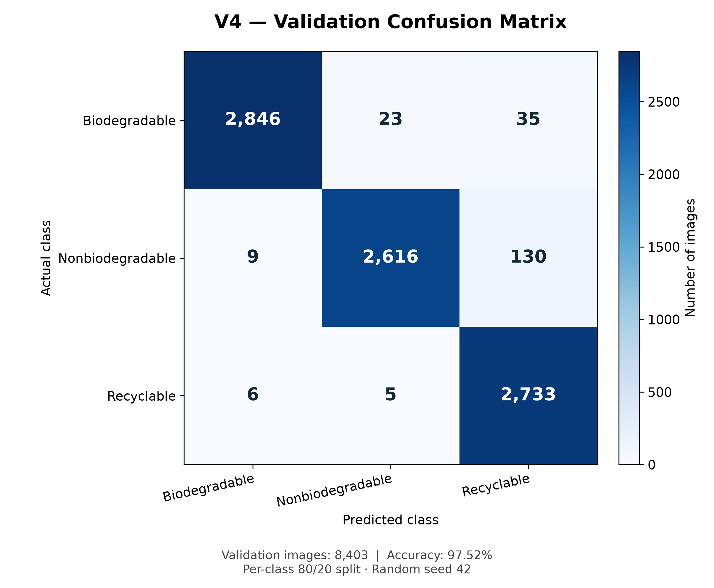

# Team Details -
Yalamanchili Vatsal-20233585\
Tanishq Gupta-20233290\
Tanishk Agrawal-20233289\
Vaibhav Singh-20233300\

# Waste Segregation Using Deep Learning — Team-05

An academic project by **Team-05** that classifies waste photographs as **Biodegradable**, **Nonbiodegradable**, or **Recyclable**. The Streamlit application lets a reviewer upload an image and view its predicted class and model scores.

## How it works

V4 uses ImageNet-pretrained EfficientNetB0 and a custom classification head. It trains the head for up to 8 epochs, then fine-tunes the last 50 backbone layers for up to 20 epochs while keeping Batch Normalization frozen. Early stopping can shorten training. The checkpoint with the best validation accuracy across both stages is saved as `best_model_v4_fixed.keras`.

Images are converted to RGB, resized to 224 × 224 with bilinear interpolation, and kept in the 0–255 range. EfficientNetB0 includes rescaling. Training uses augmentation and a per-class 80/20 training/validation split with seed 42.

## Final GitHub submission

| File or folder | Purpose |
| --- | --- |
| `waste_demo.py` | Streamlit application |
| `best_model_v4_fixed.keras` | Complete trained V4 model; the only model needed for the demo |
| `train_v4.py` | Portable V4 training script derived from the final notebook |
| `requirements.txt` | Dependencies pinned to versions in the existing V4 environment |
| `NoteBooks/version_4_latest.ipynb` | Original training workflow and recorded outputs |
| `utils/v4_confusion_matrix.py` | Validation evaluation script |
| `results/` | Confusion matrix, classification report, and evaluation details |
| `README.md`, `.gitignore`, `LICENSE` | Documentation, exclusions, and license |


## Run the application

Use **Python 3.12**. The checkpoint needs compatible Keras; this environment pins Keras 3.15.1.

1. Clone the repository and enter its folder:

```bash
git clone <YOUR-NEW-REPOSITORY-URL>
cd <YOUR-REPOSITORY-FOLDER>
```

2. Create an environment and install dependencies. On Windows, use PowerShell:

```powershell
py -3.12 -m venv .venv
.\.venv\Scripts\python.exe -m pip install --upgrade pip
.\.venv\Scripts\python.exe -m pip install -r requirements.txt
```

On macOS or Linux:

```bash
python3.12 -m venv .venv
.venv/bin/python -m pip install --upgrade pip
.venv/bin/python -m pip install -r requirements.txt
```

3. Ensure `best_model_v4_fixed.keras` is in the same folder as `waste_demo.py`. Start the application:

```powershell
# Windows
.\.venv\Scripts\python.exe -m streamlit run waste_demo.py
```

```bash
# macOS / Linux
.venv/bin/python -m streamlit run waste_demo.py
```

4. Open the local URL printed by Streamlit (normally `http://localhost:8501`). Upload a JPG, JPEG, PNG, or WebP image. View the predicted class and scores. Press Ctrl+C in the terminal to stop the server.

## Evaluation results

The saved evaluation reports **97.52% validation accuracy on 8,403 images**, using the per-class 80/20 split recreated with seed 42. This is validation performance, not an independent test-set result or a guarantee for new photographs.



See `results/classification_report.txt` for precision, recall, and F1 per class. With the dataset and model available, regenerate evaluation using:

```powershell
# Windows
.\.venv\Scripts\python.exe utils/v4_confusion_matrix.py
```

```bash
# macOS / Linux
.venv/bin/python utils/v4_confusion_matrix.py
```

The evaluation script writes to `output/v4_confusion_matrix/`; `results/` contains submission copies. Changing dataset contents can change the recreated split and metrics.

## Team

**Team-05** — Waste Segregation Using Deep Learning.

## License

See [LICENSE](LICENSE). Check dataset and sample-image permissions separately.

